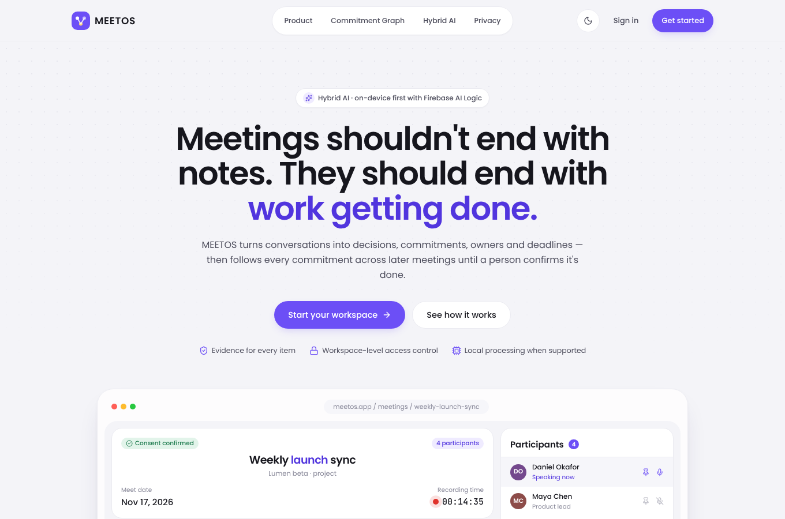
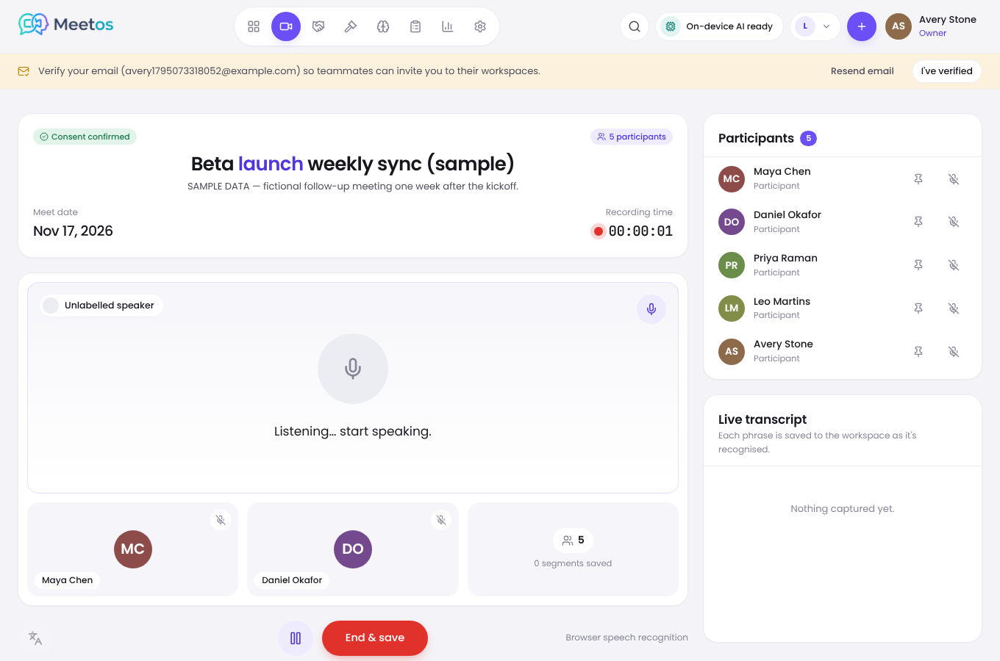
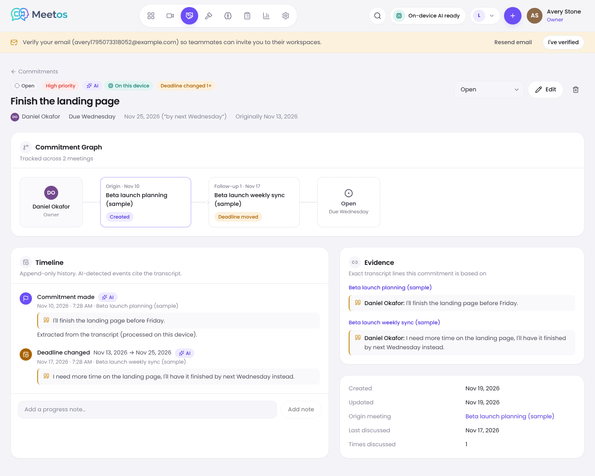

# MEETOS

**Meetings shouldn't end with notes. They should end with work getting done.**

MEETOS is an AI meeting-intelligence and execution platform. It turns conversations into
decisions, commitments, owners and deadlines — then follows every commitment across later
meetings until a person confirms it's done.

Built for the Firebase **#BuildHybridAI** hackathon: transcript analysis runs **on-device**
through Firebase AI Logic hybrid inference whenever the browser or phone supports it, and in
the **cloud** (Gemini via Firebase AI Logic) otherwise — and every result says which one
actually ran.

| | |
|---|---|
| Web app | `apps/web` — Vite + React 19 + TypeScript + Tailwind v4 (primary target, deployed on Vercel) |
| Android app | `apps/android` — Kotlin + Jetpack Compose, Room, Firebase Android SDK |
| Shared logic | `packages/shared` — domain model, grounding, chunking, linking, retrieval, metrics |
| Firebase | `firebase/` — security rules, indexes, rules tests |
| Docs | [`docs/SETUP.md`](docs/SETUP.md) · [`docs/HYBRID_AI.md`](docs/HYBRID_AI.md) · [`docs/ARCHITECTURE.md`](docs/ARCHITECTURE.md) · [`docs/DEMO.md`](docs/DEMO.md) · [`docs/DEMO_TRANSCRIPTS.md`](docs/DEMO_TRANSCRIPTS.md) · [`docs/TESTING_GUIDE.md`](docs/TESTING_GUIDE.md) · [`docs/STATUS.md`](docs/STATUS.md) |

| Landing | Live meeting room | Commitment Graph |
|---|---|---|
|  |  |  |

_The Commitment Graph screenshot comes from the automated end-to-end test environment, where Chrome's on-device model is replaced by a clearly labelled test double (`apps/web/e2e/fake-language-model.ts`), so its "On this device" labels are not from real on-device inference._

## What it does

- **Commitment Graph** — every promise ("I'll finish the landing page before Friday") becomes a
  commitment with owner, deadline, priority, transcript evidence and an append-only timeline.
  Later meetings are linked automatically: progress, blockers, moved deadlines and "it's done"
  claims. **AI never completes a task** — a person confirms it (enforced in Firestore rules too).
- **Decision memory** — what was decided, who agreed (only if the transcript says so),
  alternatives discussed, and when a later decision replaced it.
- **Memory** — ask "What happened to the website redesign?" and get an answer generated only
  from retrieved workspace records, with citations. If nothing relevant exists, it says so
  without calling a model.
- **Prepare for meeting** — a briefing of outstanding/overdue commitments, decisions since last
  time, open questions and blockers, with an AI-suggested (or rule-based) agenda you can edit and save.
- **Execution monitor** — completion rate, overdue, blocked, repeatedly postponed and stale
  commitments, by owner and project — computed from real records, with honest empty states.
- **Daily Brief** — deterministic facts from your workspace, plus an optional AI wording.
- **Live capture** — browser / Android speech recognition with an explicit consent gate and an
  always-visible recording indicator; or paste / upload `.txt`, `.md`, `.vtt`, `.srt`.

## Trust by construction

Every AI-extracted item must quote the transcript. MEETOS verifies the quote exists, resolves
owners only to people who are actually in the meeting, resolves deadlines only from words that
were actually spoken, and discards anything it can't ground (the UI reports how many items were
discarded). See [`docs/HYBRID_AI.md`](docs/HYBRID_AI.md).

## Quick start (local, no Firebase project needed)

Requires Node 22+, pnpm 10, Java 21 (for the Firebase emulators).

```bash
pnpm install
```

```bash
pnpm emulators
```

In a second terminal:

```bash
pnpm dev:emulators
```

Open http://localhost:5173, create an account, and choose **Create demo workspace** (clearly
labelled sample data). With emulators there is no real Firebase project, so **cloud** AI calls
fail; **on-device** AI works in a supported desktop Chrome. To use cloud Gemini, connect a real
project — see [`docs/SETUP.md`](docs/SETUP.md).

## Deploy

The web app deploys to **Vercel** (`apps/web/vercel.json`, root directory `apps/web`) or Firebase Hosting (`firebase.json`). Step-by-step: [`docs/SETUP.md` §9](docs/SETUP.md#9-run-and-deploy-the-web-app).

## Tests

| Command | What it runs |
|---|---|
| `pnpm test` | Unit tests for the shared logic (Vitest) |
| `pnpm test:rules` | Firestore security-rules tests against the emulator |
| `pnpm test:e2e` | Playwright end-to-end tests against the Auth + Firestore emulators |
| `pnpm typecheck` / `pnpm lint` | TypeScript and ESLint |
| `pnpm build` | Production web build |
| `cd apps/android/verify && gradle test` | Kotlin analysis-core tests on a plain JVM |
| `cd apps/android && ./gradlew :app:assembleDebug` | Android build (needs Android SDK + `google-services.json`) |

The e2e suite drives the **real Firebase AI Logic SDK**. Because headless Chromium has no
built-in model, it installs a clearly-labelled test double for Chrome's `LanguageModel` API;
the SDK still does the routing, passes the JSON-schema `responseConstraint`, and reports
`inferenceSource`.

## License

Apache-2.0 — see [`LICENSE`](LICENSE).
